# Scoring 10U Softball

## Why a Different Scoresheet?

10U softball is chaos. Walks load the bases, passed balls move everyone, overthrows score runs nobody earned. Standard scoresheets—built for tidy innings with outs—fall apart when an inning has twelve batters and four runs before anyone makes contact.

This repo contains a scoresheet adapted for the joys of 10U softball.  Sure, someone is probably poking at their phone with some online play by play tracking system, but paper is fun too.

In the repo is:
- a tutorial explanation of the scoring approach (rest of this README)
- printable sheets, landscape and portrait: `scoresheet_letter_tracks_landscape.html` and `scoresheet_letter_tracks_portrait.html` (and see the bottom for a plain notepad paper approach)
- `generate_scoresheet.py` (Claude written), which makes the sheets and can be used for customization
- `make_example.py`, which draws the full example below, and `make_readme_figures.py`, which draws the small figures in this README (`figures/`)

Here's a filled-in sheet, one inning for each team:

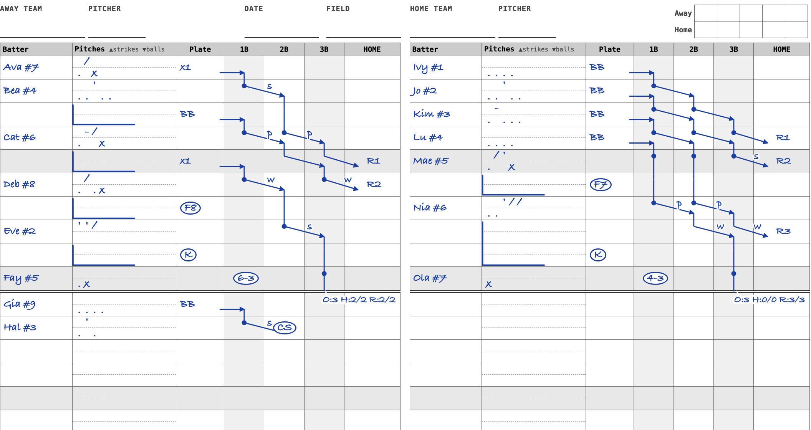

## How to use

This system is **action-centric**. Each row is one action that changes the game state: a batter action (a hit! an out!), or a runner movement (a steal, a passed ball, runs scored). It's 10U softball, so runners advancing on passed balls and overthrows are a big part of things, not to mention exciting tags at home (dropped 3rd strikes, anyone?)

Three ideas carry the whole sheet:

- **All of a batter's pitches go on their first row**, even pitches thrown after a runner moved. The count is always in one place.
- **Plate holds only the batter's own result**: a hit, a walk, an out.
- **Runner lines tell the story of the bases.** When a runner moves, the cause (`p` passed ball, `w` wild pitch, `s` steal, …) is written on their line.

You read the game downward like a timeline, not around a diamond per batter. The base columns show where every runner is at every moment.

---

## The Sheet Layout

The sheet is landscape, with one team on each half.

| Column | What Goes Here |
|--------|----------------|
| Batter | Player name and jersey number (e.g., `Ava #7`), on the first row of their at-bat only. |
| Pitches | Every pitch of the at-bat, on the batter's first row, on two tracks: strikes and fouls above the dashed line, balls and contact below. |
| Plate | The batter's result: `x1` `x2` `x3` `x4` for hits, `BB`, `HBP`, `FC`, `K d3`, and outs (circled). |
| 1B, 2B, 3B | Runner lines. Outs at a base are circled in that base's column. |
| HOME | Runs scored, numbered through the inning: R1, R2, … |

Rows are 30px, which gives 21 rows per team on a landscape page. The columns tell a spatial story: Plate → 1B → 2B → 3B → HOME. Every out goes where it happened.

---

## Your First Inning

Here's a quiet inning. Three outs, no runs. Read it top to bottom:

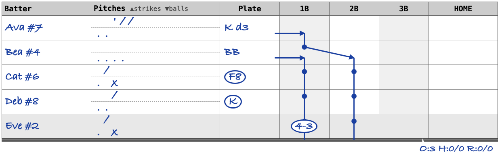

**Ava #7** sees five pitches. Above the line: `'` (strike looking), `/` (strike swinging), `/` (strike swinging). Below the line: `..`, two balls. That's three strikes, but the catcher drops strike three and Ava beats it to first. `K d3` in Plate records a dropped third strike: a strikeout for the pitcher, but not an out, so it isn't circled. The line from Plate into 1B shows her reaching base.

**Bea #4** sees four balls: `....` below the line, `BB` in Plate. Bea's line runs from Plate into 1B. Ava is forced to 2B, so her line leaves 1B near the top of Bea's row and arrives at 2B near the bottom. The line has no label, because she moved on the batter's play.

**Cat #6** sees a ball and a swinging strike, then makes contact: `x` sits below the line with the balls. The circled `F8` in Plate is a fly ball caught by the center fielder (8). **Circles always mean an out.** A fly out resolves at the plate and field, since the batter never reaches a base, so it goes in Plate.

**Deb #8** takes two balls and swings through strike three: circled `K`.

**Eve #2** grounds out to second: circled `4-3` in the 1B column. The second baseman (4) fielded it and threw to first (3). It's in the 1B column because that's where the out was made; Plate is blank because nothing happened at the plate.

Ava and Bea **hold** their bases. Holding is a straight vertical line down the base's column. A **dot** marks each occupied base at the start of every at-bat, so reading across a batter's first row shows who was on base when they came up. At three outs both runners are stranded, and their lines end at the inning's double line, where the inning summary is written.

---

## Pitch Marks

| Mark | Meaning | Track |
|------|---------|-------|
| `.` | Ball | below the line |
| `x` | Contact (bat hit ball) | below the line |
| `/` | Strike swinging | above the line |
| `'` | Strike looking | above the line |
| `-` | Foul | above the line |

Write the marks left to right in the order they're thrown, each in its own slot, so the two tracks stay in step. To read the count, tally each track: balls below, strikes above. A foul only adds a strike until there are two, so with two strikes, further fouls are just extra marks above the line.

Pitch marks never cause a new row on their own. A new row starts when something happens: the batter's result, or a runner moving.

### Optional pitch quality marks

For coaches who want pitch-location data after the game, a ball can be written as a direction mark instead of a dot: `^` high, `v` in the dirt, `<` way left, `>` way right. They still sit below the line and still count as balls.

A swinging strike at a bad pitch, a chase, can be written as a squiggly `/` above the line. It still counts as a strike. A called strike needs no mark: the umpire said it was in the zone.

---

## How At-Bats End: Batter Results

These go in Plate and end the at-bat. The next batter starts on a new row.

| Plate | Meaning |
|-------|---------|
| `x1` `x2` `x3` `x4` | Single, double, triple, home run (the `x` makes contact easy to spot) |
| `BB` | Walk |
| `HBP` | Hit by pitch |
| `FC` | Fielder's choice: batter safe, another runner out |
| `CI` | Catcher interference: batter to 1B (rare) |
| circled `K` | Strikeout. Look at the last strike to see swinging (`/`) or looking (`'`) |
| circled `F7` `F8` `F9` | Fly out to left, center, right |
| circled `L3` etc. | Line drive caught by that fielder |
| *(blank)* | Groundout: the circled play goes in the base column where the out was made |

A batter who reaches draws a horizontal line from Plate into the base they reached, on the result row. Doubles and triples run further; the longer lines are a visual celebration :)

**Dropped third strike:** write `K d3` in Plate. It's a K for the pitcher but not necessarily an out, very strange, classic 10U. The three ways it can go:

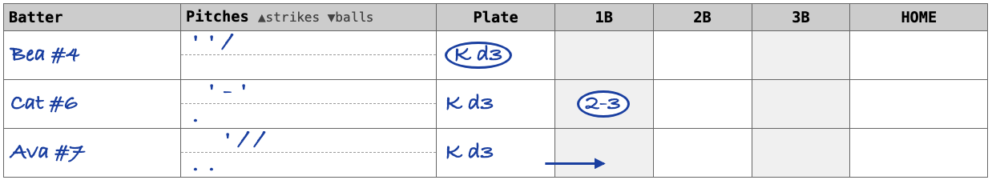

- **Bea**: tagged before she leaves the plate, so `K d3` is circled.
- **Cat**: the catcher throws to first, circled `2-3` in 1B. `K d3` itself isn't circled; the out is at first.
- **Ava**: safe. She draws her line into 1B.

---

## Drawing Runners

- **Moves stay inside their row.** A runner leaves a base near the *top* of the row where the action happened and arrives at the new base near the *bottom*. Because a runner can only take a base after the runner ahead has left it, lines never cross.
- **Holding a base is a straight vertical line** down that base's column. A diagonal only appears on the row where the runner actually moved.
- **Put a dot at each occupied base at the start of a new at-bat.**
- **The batter** draws a horizontal line from Plate into the lower part of the base box they reached, on their result row.
- **An out** ends the line at a circled play, with no arrowhead.
- **A stranded runner's** line ends at the inning's double line.
- **A run** ends the line in HOME, labelled R1, R2, … through the inning.

On a home run, the batter draws a long line all the way from Plate to HOME, and each runner drops down into it with a short diagonal inside their own base's column, like tributaries joining a river:

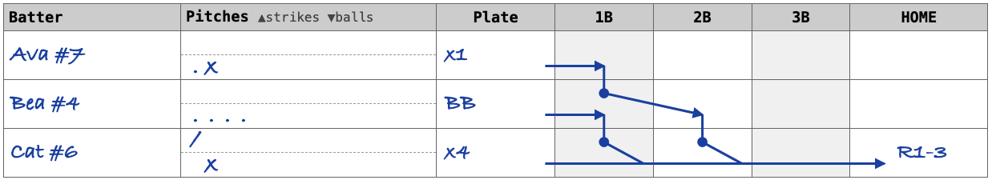

---

## The 10U Reality: Runner Causes

When a runner moves on something other than the batter's play, write the cause on their line:

| Label | Meaning |
|-------|---------|
| `p` | Passed ball (catcher should have had it) |
| `w` | Wild pitch (ball got past the catcher) |
| `s` | Stolen base, and an attempt that ends in a circled `CS` |
| `bk` | Balk: all runners advance one base |
| `e#` | Error or overthrow by fielder # (e.g. `e4`) |
| `sf` | Scoring on a sacrifice fly |
| *(none)* | Forced, or moved on the batter's play |

A runner action ends the row, but not the at-bat. The batter keeps hitting on the next row, and their pitches keep going on their first row.

Here's Ava on first when the catcher can't hold onto anything:

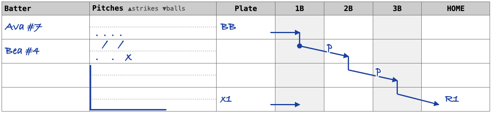

- Ava walks.
- Bea comes up. A pitch gets by the catcher: Ava's line goes from 1B to 2B, labelled `p`. The row ends, but Bea is still hitting.
- Another one: `p` again, Ava to 3B.
- Bea singles: `x1` in Plate, her line into 1B, and Ava scores (R1) on the hit, so that line has no label.

Bea's pitches are all on her first row: `. / . / x`, a 2-2 count before the single. You give up knowing *which* pitch each passed ball came on, but the count is always readable at a glance.

### When a Runner Doesn't Make It

Ava triples, and Eve comes up to bat. A wild pitch, and Ava heads for home, but the catcher recovers and throws to the pitcher covering home:

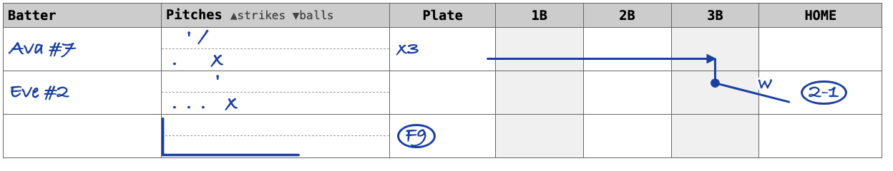

Ava's line is labelled `w` and ends at a circled `2-1` in HOME: the catcher (2) threw to the pitcher (1) for the tag. Eve's at-bat continues, and she flies out to right (circled F9).

---

## Long At-Bats: the L

When an at-bat runs over several rows, draw an **L** on its continuation rows. The vertical stroke runs down the Batter | Pitches border, and the foot goes about 3/5 of the way across the Pitches box at the bottom of the at-bat. Any row with an L has its pitches on the batter's first row above it. Single-row at-bats don't need an L.

### The Chaos Inning

Three walks load the bases, then contact turns into a multi-run avalanche:

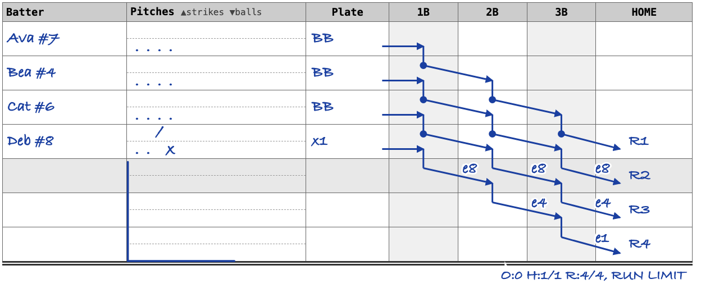

Deb singles: Ava scores (R1), everyone moves up. But the throws go wild:

- `e8`: the center fielder's throw gets away. Everyone moves up again, and Bea scores (R2).
- `e4`: the second baseman's overthrow toward third. Cat scores (R3).
- `e1`: the pitcher's overthrow at home. Deb scores (R4), and that's the run limit.

One swing of the bat, four runs, the agony of 10U! Each throw is its own row, so you can see exactly how it unravelled. The rows all belong to Deb's at-bat, so they carry her L.

### A Medium Inning

Here's an inning with multiple runner actions: 4 runs, hitting the run limit:

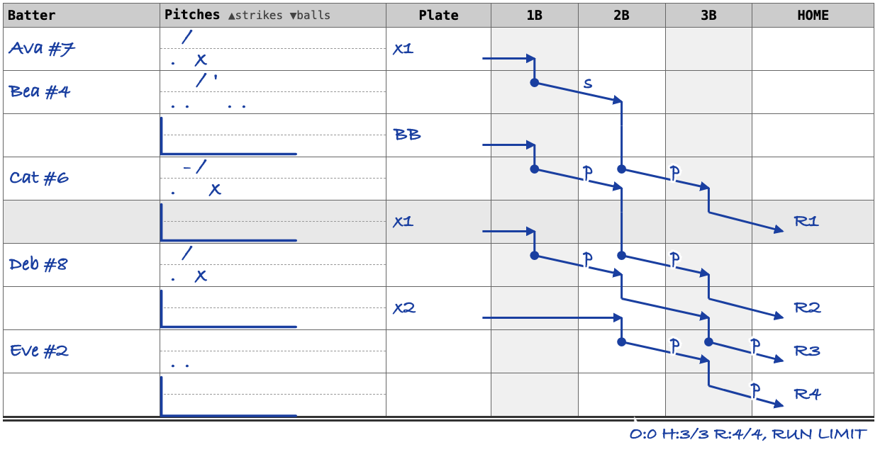

- **Ava #7** singles on the third pitch. One row, done.
- **Bea #4** is up. Ava steals second (`s`). The row ends; next row, Bea walks. All six of Bea's pitches are on her first row: two strikes above the line, four balls below.
- **Cat #6**: a passed ball (`p`) moves both runners up. Next row, Cat singles. Ava scores (R1).
- **Deb #8**: another passed ball moves Cat and Bea up. Next row, Deb doubles. Bea scores (R2), Cat goes to 3rd, and Deb's line runs from Plate all the way into 2B.
- **Eve #2**: passed ball, Cat scores (R3). Another passed ball, Deb scores (R4). Run limit. Eve's at-bat never finishes.

Every row ends with something happening. No wasted rows. You can count a pitcher's pitches by reading down the Pitches column.

---

## Inning Boundaries and Summaries

When an inning ends, draw a double line under its last row, across all columns. Write the summary just under the double line at the HOME end:

`O:2 H:3/5 R:1/4`

- O: outs this inning
- H: hits this inning / running game total
- R: runs this inning / running game total

Add `RUN LIMIT` when the inning ended on the run limit. If the pitcher changes for the next inning, write `P↓Name#N` at the left end of the double line.

---

## Advanced Plays

### Stolen Base and Caught Stealing

A steal happens on a pitch. The runner's line carries `s`, the row ends, and the at-bat continues. A runner caught stealing gets a circled `CS` in the base they were heading for, and the line stops there:

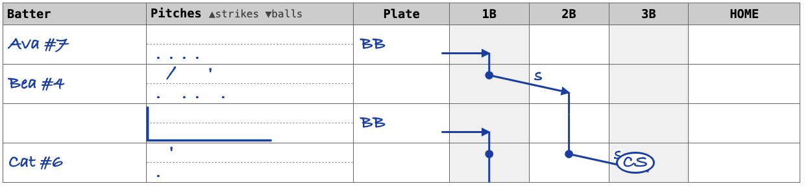

### Runner Leaving Early

Runners can't leave the base until the pitch is released (some 10U leagues say until the ball crosses the plate). A runner who leaves too soon is out, and "no pitch" is called. Circle `LE` in the column of the base the runner left. Their line ends there. Leave the cancelled pitch off the batter's pitches, because the batter's count doesn't change:

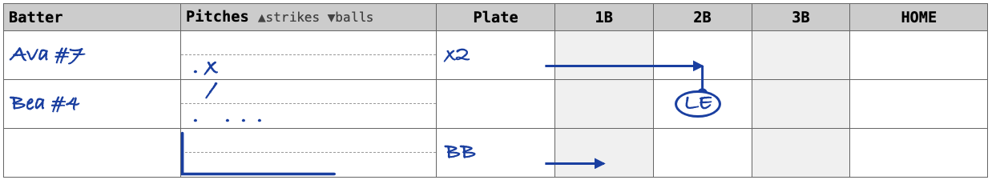

Some rec leagues give a warning the first time instead of calling the out. If so, the runner's line just keeps holding, and a `#` scorer note in the margin records the warning.

### Sacrifice Fly

The batter is out, but a runner tags up and scores. The batter gets the circled fly out in Plate, and the runner's line into HOME on the same row is labelled `sf`:

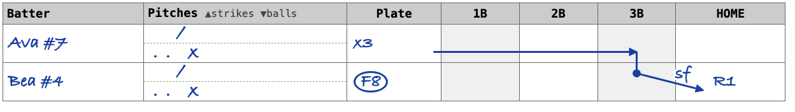

### Double Play

Each out is circled where it happened. Here the pitcher fields it and throws to the shortstop covering second, who gets Ava (circled `1-6` at 2B), then relays to first for the batter (circled `6-3` at 1B):

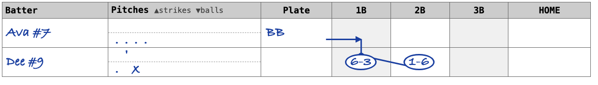

### Fielder's Choice

The batter reaches safely while a different runner is retired. `FC` goes in Plate, the batter draws her line into 1B, and the retired runner's line ends at a circled play:

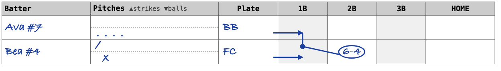

Ava is out at second, shortstop to second baseman: circled `6-4`.

---

## Pitcher Tracking

Write the starting pitcher in the PITCHER box at the top of the sheet.

**At inning boundaries:** write the incoming pitcher at the left end of the double line as `P↓Name#N`. Leave it off if the pitcher isn't changing.

**Mid-inning changes:** write `PC: Mia#3` in the Batter column of the next row before the next batter.

### Scorer Notes

Use `#` for a short comment in the margin or across an empty part of the row, e.g. `# Ava#7 injured on play, replaced by Fay#10`.

---

## Batter Blocks

A batter block is all the rows belonging to one plate appearance. The rules:

1. The batter's name **and all their pitches** go on the **first row** of the block.
2. The block has one row per action: runner actions during the at-bat, then the batter's result. Rows that follow from the same play (overthrows after a hit) belong to it too.
3. Every row after the first gets the **L**.
4. **Runner actions** appear mid-block and do **not** end it. The block ends on exactly one batter result in Plate (or the inning ending mid-at-bat).

---

## Reference

### Complete Symbol Table

| Symbol | Where | Meaning |
|--------|-------|---------|
| `.` | Pitches, below the line | Ball |
| `^` `v` `<` `>` | Pitches, below the line | Optional: ball high, in the dirt, way left, way right |
| `x` | Pitches, below the line | Contact (bat hit ball) |
| `/` | Pitches, above the line | Strike swinging (optionally squiggly for a chase) |
| `'` | Pitches, above the line | Strike looking |
| `-` | Pitches, above the line | Foul |
| `x1` `x2` `x3` `x4` | Plate | Single, double, triple, home run |
| `BB` | Plate | Walk |
| `HBP` | Plate | Hit by pitch |
| `FC` | Plate | Fielder's choice |
| `CI` | Plate | Catcher interference, batter to 1B |
| `K d3` | Plate | Dropped third strike (circled if out at the plate) |
| circled `K` | Plate | Strikeout |
| circled `F#`, `L#` | Plate | Fly out, line drive caught by fielder # |
| circled `4-3` etc. | Base column | Out made at that base |
| circled `CS` | Base column | Caught stealing |
| circled `LE` | Base column | Out for leaving the base early |
| `p` `w` `s` | Runner line | Passed ball, wild pitch, steal |
| `bk` `e#` `sf` | Runner line | Balk, error/overthrow by #, sacrifice fly |
| circle | anywhere | An out |
| dot | Base column | Base occupied at the start of an at-bat |
| L | Batter / Pitches border | Continuation row of an at-bat |
| R1, R2, … | HOME | Runs, numbered through the inning |
| `#` | Margin | Scorer note |
| `P↓Name#N` | Double line | Pitcher for the next inning |
| `PC: Name#N` | Batter | Mid-inning pitching change |

### Fielder Position Numbers

```
    7  8  9           LF   CF   RF
  5  6  4  3         3B  SS  2B  1B
       1                    P
       2                    C
```

| # | Position | | # | Position |
|---|----------|-|---|----------|
| 1 | Pitcher | | 6 | Shortstop |
| 2 | Catcher | | 7 | Left Field |
| 3 | First Base | | 8 | Center Field |
| 4 | Second Base | | 9 | Right Field |
| 5 | Third Base | | | |

The numbering follows baseball convention. Note that SS is 6 (to the left of 2B who is 4) — this can feel counterintuitive at first. Apparently historically SS was once a sort of out fielder that came closer over time.

### Fielding Notation Quick Reference

Plate/field outs (batter never reached a base) go in Plate. Base outs go in the base column where the out was made. All outs are circled; errors never are.

| Code | Meaning | Location |
|------|---------|----------|
| F7, F8, F9 | Fly out to LF, CF, RF | Plate |
| L3 | Line drive caught by 1B | Plate |
| 4-3, 6-3, 5-3, 1-3 | Groundout to 1B from 2B, SS, 3B, P | 1B |
| 3 | Unassisted out at 1B | 1B |
| 2-3 | Catcher to 1B (e.g., dropped 3rd strike) | 1B |
| 2-1 | Catcher to pitcher at home | HOME |
| 1-6, then 6-3 | Double play: each out circled at its base | 2B and 1B |
| CS | Caught stealing | destination base |
| LE | Out for leaving early | base the runner left |
| e# | Error by position #, no out | runner line |

### Making the Sheet

```
python3 generate_scoresheet.py                         # letter, landscape
python3 generate_scoresheet.py --orientation portrait
```

- Landscape, one team per half; portrait also works
- Rows are 30px: 21 rows per team per landscape page. `--row-height` changes this; 24px gives 26 rows, 27px gives 23
- Long games spill to a second sheet

To change the example sheet, edit the game data at the top of `make_example.py` and run it. It rebuilds `example_tracks.html` and, if Chrome is installed, `example_tracks.png`. The small figures in this README are built the same way by `make_readme_figures.py`.

---

## Scoring Without a Pre-Printed Sheet

Any lined notebook works. The horizontal lines become rows naturally. For columns, tear out a sheet and slide it behind the current page as a backer, rotated 90° so its lines run vertically through the page — they'll show through as column guides.

Approximate column widths in notebook lines (turned 90°):

| Batter | Pitches | Plate | 1B | 2B | 3B | HOME |
|--------|---------|-------|----|----|----|------|
| 2–3    | 3       | 2     | 1  | 1  | 1  | 2    |

Keep strikes in the top half of the row and balls in the bottom half; on paper you can usually do this by eye, or draw a light pencil line through the Pitches column.

You can leave the sheet behind, or if you have a ruler, you can draw light pencil lines at the column boundaries before the game starts. You should still be able to fit both teams side by side on a larger notebook, but otherwise one team per page is fine — use facing pages for the two teams.

If the paper is too thick for the lines to show through, you can still use them to create the layout by using the lines on the edge of the torn out page. Mark columns at top, middle, and bottom. With thick paper you might be able to use the edge of the torn out sheet to make a light column.

With smaller cells for bases, you might need to write fielding outs at bases (`3-4`) across multiple columns.

---

## An Alternative Explored: Batter Rows

`--layout batter-rows` gives each batter one tall row split into three event sub-rows. The bottom sub-row is always the batter's result. It fits fewer batters per page (13 per team in landscape), and an at-bat can only hold two runner events. It's kept for comparison; see `example_batter_rows.png`.

---

## Project Management

This project is developed in conjunction with AI agents and the
[job-jobs](https://github.com/jameshowison/how-jobs) task management system.
Job state, planning documents, and work logs live in the how-jobs repo rather
than here, keeping this repo focused on the artifact.

## Design Tradeoffs

### Why this layout works for 10U

- Handles high-chaos innings naturally — passed balls, wild pitches, steals, overthrows and run limits all have clean representations
- The count is always in one place, on the batter's first row, cleanly separated from what the runners did
- Continuous flow handles batting order changes, pinch hitters, and free substitution without special machinery

### What it gives up

The sheet no longer records which pitch a passed ball, wild pitch or steal happened on — only which at-bat it happened in.

### Where traditional scorebooks win

At higher levels where batting orders are stable, outs are frequent, and coaches want per-player stat lines after the game, the traditional diamond-per-batter layout is more practical. This layout is optimized for 10U conditions: continuous batting orders, free substitution, run limits, and base-path chaos.

### Known limitation

It's hard to tally per-batter results across a game. A traditional sheet lets you read horizontally to see "3 for 4, 1 BB, 2 RBI." Here you scan vertically for each name appearance. For 10U this is usually acceptable — game-level stats matter less than getting through the inning accurately.
